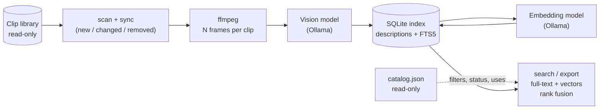

# nightshelf

Overnight indexer that makes a local video clip library searchable by meaning.

A stock-clip library grows until nobody remembers what is in it, and file names
like `clip_0412.mp4` say nothing. nightshelf looks at a few frames of every
clip with an open-weight vision model running on your own machine, writes a
short description, stores it in a local SQLite database, and lets you search
the library from the command line ("rainy city at night", "someone walking a
dog on a beach"). Nothing leaves your network, the library is only ever read,
and the whole library is processed unattended, overnight.

## How it works



1. **scan / sync** walks the library, compares each clip (key, size, mtime in
   seconds) with the index, and marks clips as new, changed, unchanged or
   removed. Removed clips are flagged, never deleted.
2. **describe** extracts `FRAME_COUNT` evenly spaced frames with ffmpeg
   (JPEG, at most 896 px), sends them to a vision model and stores a
   description, subjects, setting, time of day and mood. Each clip is committed
   on its own, so an interrupted run loses at most the clip in progress.
3. **embed** turns each description into a vector with an embedding model.
4. **search** combines SQLite full-text search (FTS5) and cosine similarity
   over the stored vectors with reciprocal rank fusion, then applies the filters
   from the read-only `catalog.json`. **export** writes the same shortlist to a
   file.

## Requirements

- Java 21 and Maven 3.9+ (to build)
- ffmpeg and ffprobe on the PATH
- A running [Ollama](https://ollama.com) with a vision model and an embedding
  model, for example `ollama pull gemma3:4b` and `ollama pull nomic-embed-text`

## Quick start

With the jar:

```
mvn package
export CLIPBANK_DIR=/path/to/clips        # read-only; contains catalog.json
export OLLAMA_URL=http://localhost:11434
java -jar target/nightshelf-0.1.0-SNAPSHOT.jar run --max-clips 5   # dry run
java -jar target/nightshelf-0.1.0-SNAPSHOT.jar run                 # the real thing
java -jar target/nightshelf-0.1.0-SNAPSHOT.jar search "rainy city at night"
```

With Docker (the image holds Java 21 and ffmpeg; Ollama stays outside):

```
cp .env.example .env        # then edit it; .env is git-ignored
docker compose build
docker compose run --rm indexer run --max-clips 5
docker compose run --rm indexer stats
docker compose run --rm indexer search "rainy city at night"
```

Below, `nightshelf` stands for `java -jar target/nightshelf-0.1.0-SNAPSHOT.jar`.

## Commands

| Command | What it does |
|---------|--------------|
| `scan` | Counts the clips in the library. Touches nothing. |
| `describe <clip.mp4>` | Describes one clip and prints the result; handy to try a model setup. |
| `sync` | Scans the library and updates the index. No model is called. |
| `run [options]` | The overnight pass: scan, sync, describe what is pending, embed. |
| `stats` | Prints the last run and the totals of the index. |
| `embed` | Computes the missing vectors for the current `EMBED_MODEL`. |
| `search "<text>" [options]` | Hybrid search over described clips. |
| `export "<text>" --format md\|csv\|json --out <file> [options]` | Writes the shortlist of a search to a file. |

Without arguments, `nightshelf` prints the effective configuration. An unknown
command or invalid arguments print one line and exit with status 2.

### sync

```
nightshelf sync
```

Added clips become pending, changed clips go back to pending, clips that
vanished are flagged as removed (never deleted), and a removed clip that comes
back is un-flagged.

### run

```
nightshelf run [--max-clips N] [--time-budget MINUTES] \
    [--skip-embed] [--retry-failed] [--allow-mass-removal]
```

- One progress line per clip: key, seconds, `ok` or `failed: reason`.
- `--max-clips N` stops after N clips. `--time-budget` stops cleanly between
  clips once the time is used up; embedding the rest then waits for the next
  run (or for `embed`).
- SIGINT and SIGTERM (Ctrl-C, `docker stop`) finish the clip in progress,
  record it, print the summary and exit 0.
- A clip that fails is recorded and the run goes on. After 10 failures in a row
  the run stops with exit status 3 (Ollama is probably down). Failed clips are
  retried at the next run, but a clip that failed in 3 separate runs is left
  alone until you pass `--retry-failed`.
- If the scan finds no clips, or more than half of the indexed clips are missing
  from it, the run refuses with exit status 2: an unmounted library must not
  look like a deletion. `--allow-mass-removal` overrides this.
- Temporary frames are deleted after every clip, also on failure and on stop.

Each run is stored in the index (start, end, counts, total and average seconds,
models used); `stats` prints it.

### search

First compute the embeddings (only described clips without a vector for the
current `EMBED_MODEL` are processed, so changing the model recomputes
everything):

```
nightshelf embed
nightshelf search "rainy city at night" --channel mychannel --status unused --limit 10
```

If Ollama is not configured or not reachable, the search falls back to
full-text only and prints one `note:` line. Each result shows the key, the
fused score, the cosine similarity of the query to the clip (`sim 0.62`, or
`sim -` when the clip was found by full-text search only), the duration, a
one-line description, the status per channel, the channels the clip was used on
(from `catalog.json`) and the file path.

Before the full-text query is built, common English function words ("the",
"in", "with", ...) and the words nearly every description repeats ("video",
"clip", "shows", "scene", ...) are dropped from it. If nothing is left, the
original words are used. A leading "The video shows ..." is also removed from
the description when it is printed; the stored text and the vectors are not
changed.

| Option                 | Meaning |
|------------------------|---------|
| `--channel NAME`       | Look at the status and uses of this channel |
| `--status S`           | With `--channel`: `approved`, `rejected`, `unused` or `any`. `unused` means never used on the channel **and** not rejected for it. Default: hide only the clips rejected for the channel |
| `--orientation O`      | Only clips with this orientation in the catalog |
| `--min-duration SEC`   | Only clips at least this long in the catalog |
| `--min-similarity X`   | Keep only results whose cosine similarity is at least X (0 to 1). Off by default. Results found by full-text search only have no similarity and are dropped when this is set |
| `--limit N`            | Number of results, 1 to 50 (default 10) |

### export

```
nightshelf export "rainy city at night" --channel mychannel --status unused \
    --format csv --out ~/shortlists/rain.csv --limit 20
```

Takes the same filters as `search` and writes the shortlist: key, path,
duration, one-line description, status per channel and the channels it was used
on. No clip is copied or moved.

- `--format md|csv|json` and `--out FILE` are required.
- The file must not be inside `CLIPBANK_DIR` (the library is read-only for this
  tool); otherwise the command refuses with exit status 2.
- An existing file is never overwritten unless you pass `--force`. A symbolic
  link at the output path is never followed, with or without `--force`.
- The file is created with permissions `0600` where the OS supports it, and
  appears only once it is complete.
- CSV cells are quoted properly, and cells that start with `=`, `+`, `-` or `@`
  get a leading `'` so a spreadsheet does not run them as formulas. In Markdown,
  pipes, newlines and markup characters are escaped. JSON is written with
  Jackson.

## Configuration

All settings come from environment variables.

| Variable       | Default                  | Purpose |
|----------------|--------------------------|---------|
| `CLIPBANK_DIR` | none                     | Clip library directory (read-only) |
| `DB_PATH`      | `~/.nightshelf/index.db` | SQLite index; must be on a local disk |
| `OLLAMA_URL`   | none                     | Base URL of the Ollama API (http or https) |
| `VISION_MODEL` | `gemma3:4b`              | Vision model used to describe frames |
| `EMBED_MODEL`  | `nomic-embed-text`       | Embedding model used for vector search |
| `FRAME_COUNT`  | `3`                      | Frames extracted per clip (1 to 12) |

## Docker

The image runs as an unprivileged user (uid 10001) and publishes no port.

- The clip library is mounted read-only at `/clipbank`; the container user must
  be able to read it.
- The index lives on the local named volume `index`. Do not point it at a
  network mount; the index refuses to open on one.
- The root filesystem is read-only, with a tmpfs for `/tmp` (frames and the
  SQLite library), all capabilities dropped and `no-new-privileges` set.
- `OLLAMA_URL` comes from the environment (`.env`); `.env.example` has
  placeholders only. If Ollama runs on the Docker host, use
  `host.docker.internal`.
- `docker compose stop` sends SIGTERM and waits up to two minutes, so the clip
  in progress is finished and recorded.
- To write an export from the container, mount an output directory of your own;
  the library mount is read-only.

An Ollama container with an NVIDIA GPU is available as a separate profile:
`docker compose --profile ollama up -d ollama`, with
`OLLAMA_URL=http://ollama:11434`. Its port is published on `127.0.0.1` of the
host only.

## Measured on a real library

One overnight run on a library of 321 clips, with `gemma3:4b` (vision) and
`nomic-embed-text` (embeddings), 3 frames per clip:

| Clips | Total time | Per described clip | Failures |
|-------|------------|--------------------|----------|
| 321   | 2874 s     | 8.9 s              | 0        |

That is one machine and one model. The "per described clip" figure that `run`
and `stats` print is the one to trust for your own setup.

## Security notes

- **Model output is untrusted.** Descriptions are length-capped, stripped of
  control characters and cut at a word boundary before they are stored or shown.
  The model is asked for JSON that matches a schema, and anything else is
  retried and then recorded as a failure.
- **No redirects, size caps.** HTTP calls to Ollama never follow redirects, have
  connect and request timeouts, are retried a bounded number of times, and a
  response above 1 MB is refused.
- **Path validation.** Clip paths are checked before they reach ffmpeg: no path
  starting with `-`, nothing whose real path is outside `CLIPBANK_DIR`, and
  symbolic links in the library are not followed. External tools are started
  with an argument list, never through a shell.
- **The library is read-only.** Nothing is written under `CLIPBANK_DIR`, and
  `catalog.json` is only read. `export` refuses to write inside the library.
- **SQLite lives on a local disk.** The index refuses to open on a network
  filesystem (SMB, NFS, AFP and similar), because locking and WAL are not
  reliable there. It exits with status 2. All SQL is parameterized, and search
  text is split into words that are each quoted, so it is never FTS syntax.
- **Plain http to Ollama.** Traffic to Ollama is unencrypted. That includes the
  frames sent to describe a clip, the descriptions sent by `embed` and every
  search query: all of it is readable by anyone on the path to the Ollama host.
  Ollama has no authentication either. Run it on `localhost`, on a trusted LAN,
  or through an SSH tunnel (for example `ssh -L 11434:localhost:11434 host`), and
  never publish its port on all interfaces.

## Limits

- Descriptions come from 3 frames per clip by default (`FRAME_COUNT`). What
  happens between those frames is not seen.
- Semantic search has no relevance threshold by default: it always returns the
  closest clips, even when nothing matches well. Use `--min-similarity` and the
  `sim` value to cut off weak results.
- Ollama traffic is unencrypted (see the security notes).
- The index was tested on a local disk and with a local Ollama. Network
  filesystems are detected by type, not exercised.

## Build and test

```
mvn package
```

Tests use invented data and local stub servers; no real clip or model is
needed. Tests that call ffmpeg are skipped when it is not installed.

## License

Apache License 2.0, see [LICENSE](LICENSE).
